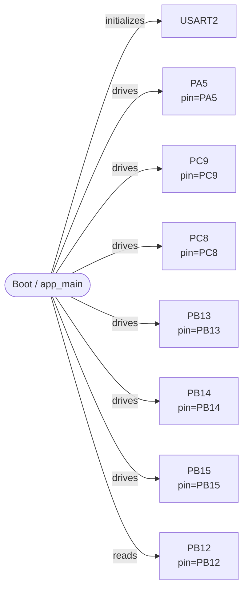
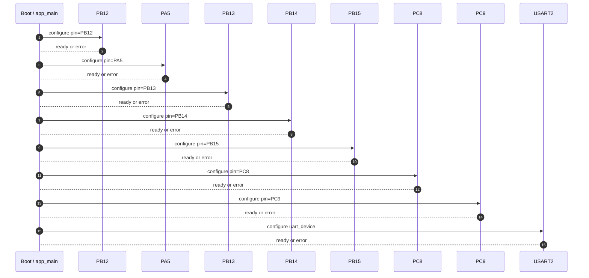
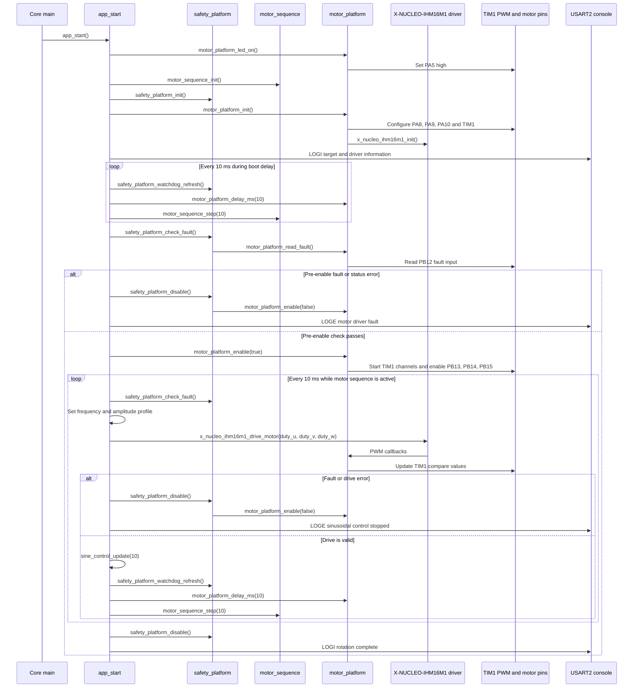
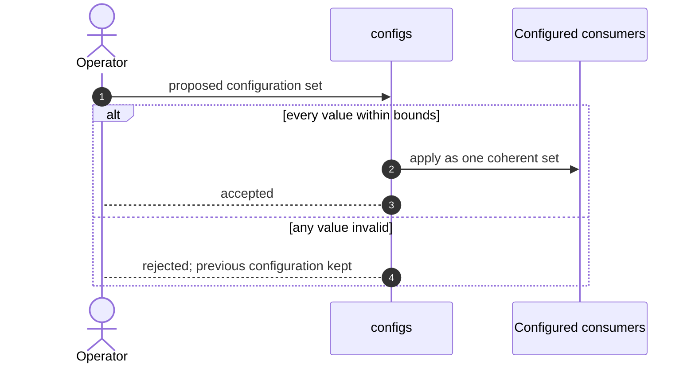

# Firmware Design Specification — motor_demo

| Field | Value |
| --- | --- |
| Document ID | FDS-MOTOR-DEMO-001 |
| Project | motor_demo |
| PIR revision | e70154ca53fb14af9b4b65599f166cde |
| Board | not recorded |
| Target | not recorded |
| Generated | 2026-09-24 06:10 UTC |
| Analysed files | 31 |
| Diagrams reviewed | not yet |
| Requirements workbook | none linked |
| Status | Generated from the as-built project |

> Generation rule: unresolved implementation details are surfaced as editable parameters or design decisions. They are not silently converted into fixed product behavior.

## 1. Purpose and Scope

### 1.1 Source Basis

| Source | Use in this specification |
| --- | --- |
| Analysed project sources (31 files) | Primary input. Every module, task flow, pin binding and partition in this document is read from these files. |
| PIR revision e70154ca53fb14af9b4b65599f166cde | The exact analysis this document describes. Regenerating after a source change produces a different revision. |

### 1.2 Modelling Basis

The structure of this document follows the information content of an IEEE 1016 software design description and the viewpoint structure of ISO/IEC/IEEE 42010. Interaction diagrams use UML sequence notation. The structure is a reference template; it does not claim certification to those standards.

### 1.4 Analysed Source Inventory

| File | Module | Module kind | Facts read from this file |
| --- | --- | --- | --- |
| CMakeLists.txt | — | — | read; no facts cited from it |
| Core/Inc/main.h | Core/Inc | module | read; no facts cited from it |
| Core/Inc/stm32g4xx_hal_conf.h | Core/Inc | module | read; no facts cited from it |
| Core/Inc/stm32g4xx_it.h | Core/Inc | module | read; no facts cited from it |
| Core/Inc/stm32g4xx_nucleo_conf.h | Core/Inc | module | read; no facts cited from it |
| Core/Src/main.c | Core/Src | module | 1 topology element(s); 2 include dependency(ies) |
| Core/Src/stm32g4xx_hal_msp.c | Core/Src | module | read; no facts cited from it |
| Core/Src/stm32g4xx_it.c | Core/Src | module | read; no facts cited from it |
| Core/Src/system_stm32g4xx.c | Core/Src | module | read; no facts cited from it |
| firmware/app/app.c | app | application | 5 include dependency(ies) |
| firmware/app/app.h | app | application | read; no facts cited from it |
| firmware/bsp/board.c | bsp | board | read; no facts cited from it |
| firmware/bsp/board.h | bsp | board | 1 include dependency(ies) |
| firmware/configs/app_config.h | configs | configuration | read; no facts cited from it |
| firmware/configs/build_config.h | configs | configuration | read; no facts cited from it |
| firmware/configs/feature_config.h | configs | configuration | read; no facts cited from it |
| firmware/configs/platform_config.h | configs | configuration | read; no facts cited from it |
| firmware/drivers/x_nucleo_ihm16m1/x_nucleo_ihm16m1/x_nucleo_ihm16m1.c | drivers/x_nucleo_ihm16m1/x_nucleo_ihm16m1 | driver | read; no facts cited from it |
| firmware/drivers/x_nucleo_ihm16m1/x_nucleo_ihm16m1/x_nucleo_ihm16m1.h | drivers/x_nucleo_ihm16m1/x_nucleo_ihm16m1 | driver | read; no facts cited from it |
| firmware/modules/motor_sequence/motor_sequence.c | modules/motor_sequence | module | 1 include dependency(ies) |
| firmware/modules/motor_sequence/motor_sequence.h | modules/motor_sequence | module | read; no facts cited from it |
| firmware/modules/sine_control/sine_control.c | modules/sine_control | module | read; no facts cited from it |
| firmware/modules/sine_control/sine_control.h | modules/sine_control | module | read; no facts cited from it |
| firmware/platforms/stm32/motor_platform.c | platforms/stm32 | platform | 8 topology element(s); 1 include dependency(ies) |
| firmware/platforms/stm32/motor_platform.h | platforms/stm32 | platform | 1 include dependency(ies) |
| firmware/platforms/stm32/safety_platform.c | platforms/stm32 | platform | read; no facts cited from it |
| firmware/platforms/stm32/safety_platform.h | platforms/stm32 | platform | read; no facts cited from it |
| firmware/utils/helpers/helpers.c | utils/helpers | utility | read; no facts cited from it |
| firmware/utils/helpers/helpers.h | utils/helpers | utility | read; no facts cited from it |
| firmware/utils/logger/logger.c | utils/logger | utility | read; no facts cited from it |
| firmware/utils/logger/logger.h | utils/logger | utility | read; no facts cited from it |

## 2. System Context and Wiring Topology

> The diagrams in this document have not been marked reviewed in the Firmware Topology panel. They describe the analysed project as it stands; review them there before treating this document as approved.

**Figure 1.** Wiring and external connectivity topology.

### 2.1 Wiring Control Table

| Connection | Baseline | Editability | Verification |
| --- | --- | --- | --- |
| PB12 | PB12 | Platform — regenerated from the board configuration | Pin is input-capable at the expected level. |
| PA5 | PA5 | Platform — regenerated from the board configuration | Pin exists on the target and is drive-capable. |
| PB13 | PB13 | Platform — regenerated from the board configuration | Pin exists on the target and is drive-capable. |
| PB14 | PB14 | Platform — regenerated from the board configuration | Pin exists on the target and is drive-capable. |
| PB15 | PB15 | Platform — regenerated from the board configuration | Pin exists on the target and is drive-capable. |
| PC8 | PC8 | Platform — regenerated from the board configuration | Pin exists on the target and is drive-capable. |
| PC9 | PC9 | Platform — regenerated from the board configuration | Pin exists on the target and is drive-capable. |

### 2.2 Dynamic Design Parameters

| Parameter group | Resolved baseline | Still requires decision |
| --- | --- | --- |
| Peripherals | 8 peripheral(s): PB12, PA5, PB13, PB14, PB15, PC8, PC9, USART2; buses: uart |  |

### 2.3 Peripheral and Interface Configuration

| Element | Type | Configured values | Source |
| --- | --- | --- | --- |
| Boot / app_main | system_init | target = stm32 | Core/Src/main.c |
| PA5 | gpio_output | pin = PA5 | firmware/platforms/stm32/motor_platform.c |
| PC9 | gpio_output | pin = PC9 | firmware/platforms/stm32/motor_platform.c |
| PC8 | gpio_output | pin = PC8 | firmware/platforms/stm32/motor_platform.c |
| PB13 | gpio_output | pin = PB13 | firmware/platforms/stm32/motor_platform.c |
| PB14 | gpio_output | pin = PB14 | firmware/platforms/stm32/motor_platform.c |
| PB15 | gpio_output | pin = PB15 | firmware/platforms/stm32/motor_platform.c |
| PB12 | gpio_input | pin = PB12 | firmware/platforms/stm32/motor_platform.c |
| USART2 | uart_device | baud_rate = 115200; port = 1 | firmware/platforms/stm32/motor_platform.c |

## 3. High-Level Design (HLD)

**Figure 2.** High-level layered firmware architecture and dependency direction.

```mermaid
flowchart TD
  main_entry["Application entry<br/>Core/Src/main.c: HAL_Init#59; app_start"]
  app_start["Motor application orchestration<br/>firmware/app/app.c: app_start"]
  motor_platform["STM32 motor platform<br/>firmware/platforms/stm32/motor_platform.c"]
  safety_platform["Safety and watchdog control<br/>firmware/platforms/stm32/safety_platform.c"]
  motor_sequence["Motor timing state machine<br/>firmware/modules/motor_sequence/motor_sequence.c"]
  sine_control["Three-phase sine controller<br/>firmware/modules/sine_control/sine_control.c"]
  ihm16m1_driver["STSPIN830 board driver<br/>x_nucleo_ihm16m1_drive_motor"]
  tim1_pwm["TIM1 three-channel PWM<br/>PA8, PA9, PA10#59; 20 kHz"]
  motor_stby["Motor standby output<br/>PC9#59; APP_MOTOR_STBY_PIN"]
  motor_mode["Motor mode output<br/>PC8#59; APP_MOTOR_MODE_PIN"]
  motor_enable_u["U enable output<br/>PB13#59; APP_MOTOR_EN_U_PIN"]
  motor_enable_v["V enable output<br/>PB14#59; APP_MOTOR_EN_V_PIN"]
  motor_enable_w["W enable output<br/>PB15#59; APP_MOTOR_EN_W_PIN"]
  motor_fault["Active-low fault input<br/>PB12#59; APP_MOTOR_EN_FAULT_PIN"]
  user_led["Status LED output<br/>PA5#59; APP_LED_GPIO_PIN"]
  usart2["Debug UART<br/>USART2 TX PA2, RX PA3"]
  uart_log["Console / UART logging<br/>printf via HAL_UART_Transmit"]

  main_entry -->|app_start#35;40#35;41| app_start
  app_start -->|motor_platform_led_on#35;40#35;41| motor_platform
  app_start -->|safety_platform_init#35;40#35;41 and checks| safety_platform
  app_start -->|motor_sequence_init and step| motor_sequence
  app_start -->|sine_control_init, profile, update| sine_control
  app_start -->|motor_platform_init, enable, drive| motor_platform
  app_start -->|LOGI / LOGE| uart_log
  motor_platform -->|HAL_GPIO_WritePin| user_led
  motor_platform -->|HAL_TIM_PWM_Init / HAL_TIM_PWM_Start| tim1_pwm
  motor_platform -->|HAL_GPIO_WritePin| motor_stby
  motor_platform -->|HAL_GPIO_WritePin| motor_mode
  motor_platform -->|HAL_GPIO_WritePin| motor_enable_u
  motor_platform -->|HAL_GPIO_WritePin| motor_enable_v
  motor_platform -->|HAL_GPIO_WritePin| motor_enable_w
  safety_platform -->|motor_platform_read_fault| motor_fault
  motor_platform -->|HAL_GPIO_ReadPin| motor_fault
  motor_platform -->|x_nucleo_ihm16m1_init / drive_motor| ihm16m1_driver
  ihm16m1_driver -->|PWM callbacks U/V/W| tim1_pwm
  ihm16m1_driver -->|GPIO callbacks STBY| motor_stby
  ihm16m1_driver -->|GPIO callback EN_FAULT| motor_fault
  motor_platform -->|HAL_UART_Init / _write| usart2
  usart2 -->|HAL_UART_Transmit| uart_log
```

### 3.1 Architectural Layers

| Layer | Source modules | Runtime and hardware elements |
| --- | --- | --- |
| Application | app | — |
| Platform and drivers | bsp, drivers/x_nucleo_ihm16m1/x_nucleo_ihm16m1, platforms/stm32 | PA5, PC9, PC8, PB13, PB14, PB15, PB12, USART2 |
| Configuration and support | configs, utils/helpers, utils/logger | Boot / app_main |

## 4. Low-Level Design (LLD)

**Figure 3.** Low-level module contracts and runtime control flow.

```mermaid
flowchart TD
  subgraph app_task["app_start execution"]
    boot["Start motor application<br/>firmware/app/app.c:47"]
    init_control["Initialize sine state and motor sequence<br/>firmware/app/app.c:54-55"]
    init_safety["Initialize watchdog and safety state<br/>firmware/app/app.c:56"]
    init_motor["Initialize GPIO, TIM1 PWM, and driver<br/>firmware/app/app.c:66"]
    boot_wait["Refresh watchdog, delay, and advance boot sequence<br/>firmware/app/app.c:71-74"]
    boot_done{"Boot delay complete — firmware/app/app.c:70"}
    precheck["Read and latch motor fault<br/>firmware/app/app.c:79"]
    precheck_ok{"Fault check passed — firmware/app/app.c:81"}
    enable["Enable three PWM channels and motor phases<br/>firmware/app/app.c:87"]
    running{"Motor sequence still active — firmware/app/app.c:94"}
    profile["Select ramp, hold, or shutdown sine profile<br/>firmware/app/app.c:95"]
    drive["Generate three duties and drive motor<br/>firmware/app/app.c:96"]
    runtime_ok{"Fault and drive status are valid — firmware/app/app.c:96"}
    update["Advance sine phase by 10 ms<br/>firmware/app/app.c:102"]
    refresh["Refresh watchdog and wait 10 ms<br/>firmware/app/app.c:103-104"]
    step["Advance motor sequence by 10 ms<br/>firmware/app/app.c:105"]
    disable_fault["Disable PWM and latch safety fault<br/>firmware/app/app.c:97-99"]
    disable_done["Disable motor after sequence completion<br/>firmware/app/app.c:109"]
    complete["Log rotation completion<br/>firmware/app/app.c:110"]
  end

  boot -->  init_control -->  init_safety -->  init_motor -->  boot_done
  boot_done -->|no#59; 10 ms| boot_wait
  boot_wait -->  boot_done
  boot_done -->|yes| precheck -->  precheck_ok
  precheck_ok -->|no| disable_fault
  precheck_ok -->|yes| enable -->  running
  running -->|yes| profile -->  drive -->  runtime_ok
  runtime_ok -->|no| disable_fault
  runtime_ok -->|yes| update -->  refresh -->  step -->  running
  running -->|no| disable_done -->  complete
```

**Figure 4.** Peripheral service state machine for initialisation, fault containment and controlled recovery.

*Not drawn — a fault and recovery state machine needs an analysed task flow carrying both a decision step and an error step. No task flow in this project has both.*

### 4.1 Module Contracts

| Module | Kind | Files | Depends on | Trace |
| --- | --- | --- | --- | --- |
| Core/Inc | module | 4 | — | Core/Inc |
| Core/Src | module | 4 | Core_Inc, app | Core/Src/main.c:20 |
| app | application | 2 | configs, modules_motor_sequence, modules_sine_control, platforms_stm32, utils_logger | firmware/app/app.c:5 |
| bsp | board | 2 | configs | firmware/bsp/board.h:18 |
| configs | configuration | 4 | — | configs |
| drivers/x_nucleo_ihm16m1/x_nucleo_ihm16m1 | driver | 2 | — | drivers/x_nucleo_ihm16m1/x_nucleo_ihm16m1 |
| modules/motor_sequence | module | 2 | configs | firmware/modules/motor_sequence/motor_sequence.c:5 |
| modules/sine_control | module | 2 | — | modules/sine_control |
| platforms/stm32 | platform | 4 | configs, drivers_x_nucleo_ihm16m1_x_nucleo_ihm16m1 | firmware/platforms/stm32/motor_platform.c:5 |
| utils/helpers | utility | 2 | — | utils/helpers |
| utils/logger | utility | 2 | — | utils/logger |

### 4.4 Include Dependencies

| From | To | Via | Symbol | Trace |
| --- | --- | --- | --- | --- |
| Core/Src | Core/Inc | include | main.h | Core/Src/main.c:20 |
| Core/Src | app | include | app.h | Core/Src/main.c:21 |
| app | configs | include | app_config.h | firmware/app/app.c:5 |
| app | modules/motor_sequence | include | motor_sequence.h | firmware/app/app.c:8 |
| app | modules/sine_control | include | sine_control.h | firmware/app/app.c:10 |
| app | platforms/stm32 | include | motor_platform.h | firmware/app/app.c:7 |
| app | utils/logger | include | logger.h | firmware/app/app.c:6 |
| bsp | configs | include | app_config.h | firmware/bsp/board.h:18 |
| modules/motor_sequence | configs | include | app_config.h | firmware/modules/motor_sequence/motor_sequence.c:5 |
| platforms/stm32 | configs | include | app_config.h | firmware/platforms/stm32/motor_platform.c:5 |
| platforms/stm32 | drivers/x_nucleo_ihm16m1/x_nucleo_ihm16m1 | include | x_nucleo_ihm16m1.h | firmware/platforms/stm32/motor_platform.h:7 |

## 5. Sequence Diagrams

**Figure 5.** Startup and initialisation sequence.

**Figure 6.** Normal acquisition, processing and output sequence.

**Figure 7.** Fault detection and controlled recovery sequence.

*Not drawn — a fault recovery sequence needs both a task flow with an error path and a diagnostics or logging sink to report it to. This project does not have both.*

**Figure 8.** Validated and atomic configuration update sequence.

**Figure 9.** Secure firmware download, verification, staging and activation sequence.

*Not drawn — no firmware update surface was found: no OTA or update node, and no OTA partition.*

## 6. Security and Update Design

### 6.1 Security and Update Surface

| Surface | Found in the analysed project | Consequence for this design |
| --- | --- | --- |
| Update slot | No OTA partition among the 0 declared | The image can only be replaced over the wire by re-flashing. |
| Update service | No OTA or update element in the topology | Figure 9 is not drawn; there is no update flow to verify. |
| Secure boot and flash encryption | Not visible to static source analysis | Confirm against the build configuration; this document cannot establish either. |

## 7. Timing and Resource Budget

| Budget item | Requirement / baseline | Design status | Closure evidence |
| --- | --- | --- | --- |
| Flash, RAM and CPU headroom | Not established by static analysis | Decision Required | Map file plus runtime resource measurement. |

## 8. Design Decision Register

> The analyser recorded no unresolved parameter at this revision, so there is no open decision to register here. Every parameter group in section 2.2 resolved to a baseline, and the items section 7 marks as requiring a decision are measurements rather than design choices.

## 9. Requirement-to-Design Traceability

> No requirements workbook is linked to this project, so no requirement can be traced to a design element here. Link one from the project picker to populate this section.

## 10. References

| Reference | Purpose |
| --- | --- |
| Project sources at revision e70154ca53fb14af9b4b65599f166cde | The implementation this document describes. |

## 11. Consolidated Design Summary

### 11.1 The Design at a Glance

| Aspect | As built at this revision |
| --- | --- |
| Target | Neither target chip nor board is recorded |
| Analysed sources | 31 file(s) across 11 module(s) and 0 build component(s) |
| Topology | 9 element(s) and 8 connection(s), of which 8 are evidenced in source |
| Peripherals | PB12, PA5, PB13, PB14, PB15, PC8, PC9, USART2 over uart |
| Runtime | No task was resolved to a defined entry function |
| Network | No network transport is configured |
| Storage | No partition table was read |
| Figures | 6 of 9 drawn; the remaining 3 state why they are not |
| Open design decisions | None recorded; every parameter group in §2.2 resolved |
| Requirement traceability | No workbook is linked, so nothing is traced |
| Diagram review | Not yet marked reviewed; the figures describe the project as analysed |
| Analysis provenance | pir_maker-static-0.13.0 in static mode; validation reports 0 error(s) and 0 warning(s) |

## 12. Appendix A — Term, API and Symbol Index

> Every term below is a name the body of this document uses, resolved against the 284 name(s) indexed from the 31 analysed source file(s). 34 term(s) are listed; 81 name-like token(s) in the document resolved to no recorded location and are omitted rather than listed without one.

| Term | Kind | Defined or referenced at | Where it appears in this document |
| --- | --- | --- | --- |
| APP_LED_GPIO_PIN | macro | firmware/configs/app_config.h:6 | figure 2 |
| APP_MOTOR_EN_FAULT_PIN | macro | firmware/configs/app_config.h:21 | figure 2 |
| APP_MOTOR_EN_U_PIN | macro | firmware/configs/app_config.h:24 | figure 2 |
| APP_MOTOR_EN_V_PIN | macro | firmware/configs/app_config.h:26 | figure 2 |
| APP_MOTOR_EN_W_PIN | macro | firmware/configs/app_config.h:28 | figure 2 |
| APP_MOTOR_MODE_PIN | macro | firmware/configs/app_config.h:30 | figure 2 |
| APP_MOTOR_STBY_PIN | macro | firmware/configs/app_config.h:19 | figure 2 |
| HAL_GPIO_ReadPin | external API | firmware/platforms/stm32/motor_platform.c:199 | figure 2 |
| HAL_GPIO_WritePin | external API | firmware/platforms/stm32/motor_platform.c:75 | figure 2 |
| HAL_Init | external API | Core/Src/main.c:55 | figure 2 |
| HAL_TIM_PWM_Init | external API | firmware/platforms/stm32/motor_platform.c:222 | figure 2 |
| HAL_TIM_PWM_Start | external API | firmware/platforms/stm32/motor_platform.c:274 | figure 2 |
| HAL_UART_Init | external API | firmware/platforms/stm32/motor_platform.c:37 | figure 2 |
| HAL_UART_Transmit | external API | firmware/platforms/stm32/motor_platform.c:50 | figure 2 |
| LOGE | macro | firmware/utils/logger/logger.h:10 | figure 2, 6 |
| LOGI | macro | firmware/utils/logger/logger.h:8 | figure 2, 6 |
| _write | function | firmware/platforms/stm32/motor_platform.c:42 | figure 2 |
| app_start | function | firmware/app/app.c:58 | figure 2, 3, 6 |
| motor_platform_delay_ms | function | firmware/platforms/stm32/motor_platform.c:318 | figure 6 |
| motor_platform_enable | function | firmware/platforms/stm32/motor_platform.c:263 | figure 6 |
| motor_platform_init | function | firmware/platforms/stm32/motor_platform.c:203 | figure 2, 6 |
| motor_platform_led_on | function | firmware/platforms/stm32/motor_platform.c:63 | figure 2, 6 |
| motor_platform_read_fault | function | firmware/platforms/stm32/motor_platform.c:300 | figure 2, 6 |
| motor_sequence_init | function | firmware/modules/motor_sequence/motor_sequence.c:7 | figure 2, 6 |
| motor_sequence_step | function | firmware/modules/motor_sequence/motor_sequence.c:15 | figure 6 |
| safety_platform_check_fault | function | firmware/platforms/stm32/safety_platform.c:27 | figure 6 |
| safety_platform_disable | function | firmware/platforms/stm32/safety_platform.c:44 | figure 6 |
| safety_platform_init | function | firmware/platforms/stm32/safety_platform.c:11 | figure 2, 6 |
| safety_platform_watchdog_refresh | function | firmware/platforms/stm32/safety_platform.c:50 | figure 6 |
| sine_control_init | function | firmware/modules/sine_control/sine_control.c:16 | figure 2 |
| sine_control_update | function | firmware/modules/sine_control/sine_control.c:33 | figure 6 |
| x_nucleo_ihm16m1 | type | firmware/drivers/x_nucleo_ihm16m1/x_nucleo_ihm16m1/x_nucleo_ihm16m1.c:4 | §1, §3, §4 |
| x_nucleo_ihm16m1_drive_motor | function | firmware/drivers/x_nucleo_ihm16m1/x_nucleo_ihm16m1/x_nucleo_ihm16m1.c:103 | figure 2, 6 |
| x_nucleo_ihm16m1_init | function | firmware/drivers/x_nucleo_ihm16m1/x_nucleo_ihm16m1/x_nucleo_ihm16m1.c:32 | figure 2, 6 |

