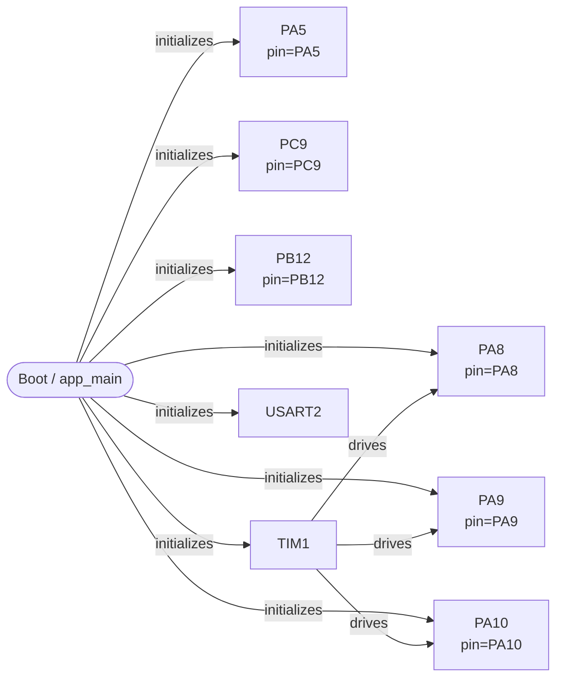
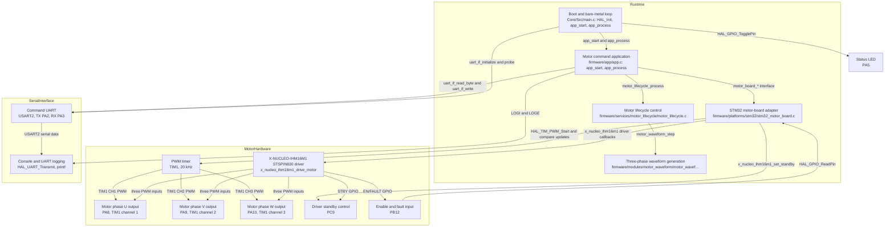
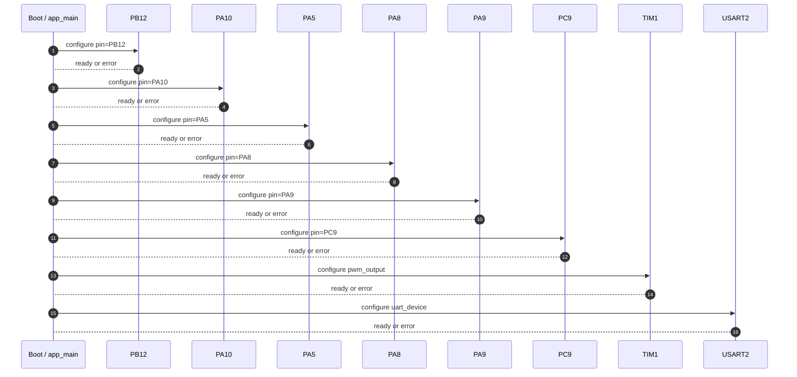
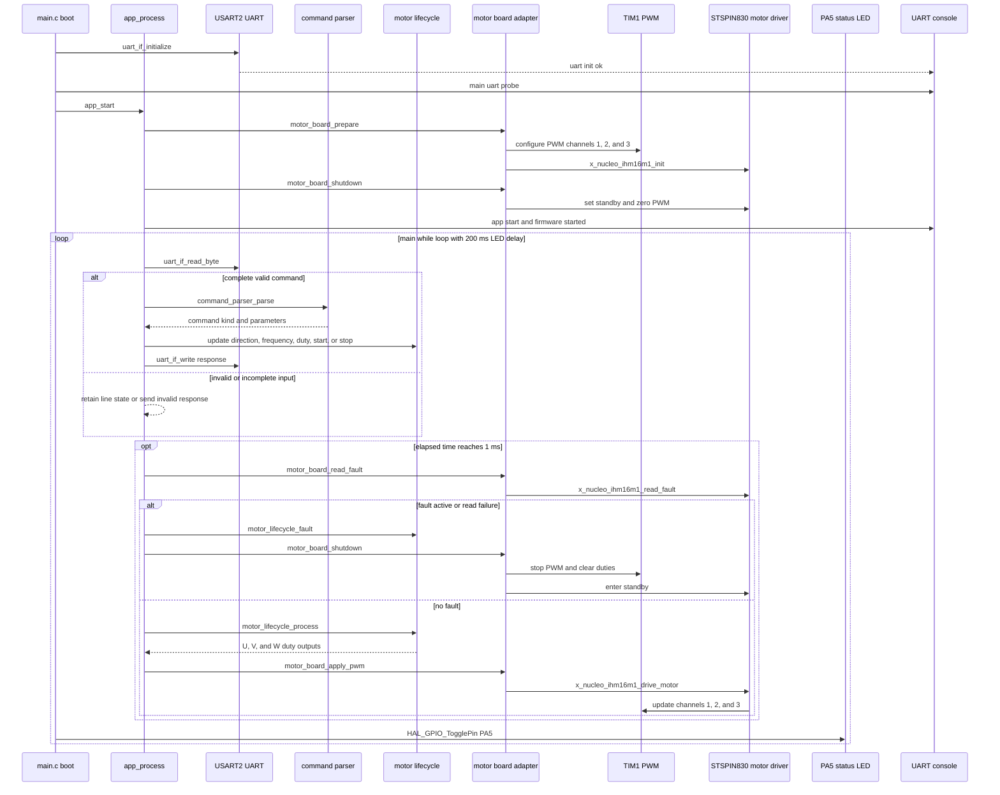
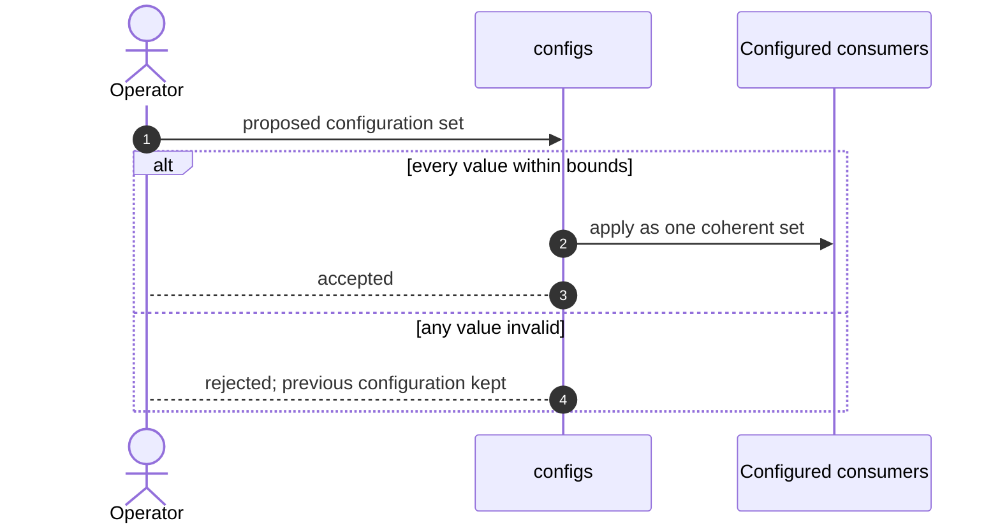

# Firmware Design Specification — open_loop_motor_control

| Field | Value |
| --- | --- |
| Document ID | FDS-OPEN-LOOP-MOTOR-CONTROL-001 |
| Project | open_loop_motor_control |
| PIR revision | 34158563458a6f901eeb72f486e1c577 |
| Board | not recorded |
| Target | not recorded |
| Generated | 2026-09-24 00:46 UTC |
| Analysed files | 38 |
| Diagrams reviewed | not yet |
| Requirements workbook | none linked |
| Status | Generated from the as-built project |

> Generation rule: unresolved implementation details are surfaced as editable parameters or design decisions. They are not silently converted into fixed product behavior.

## 1. Purpose and Scope

### 1.1 Source Basis

| Source | Use in this specification |
| --- | --- |
| Analysed project sources (38 files) | Primary input. Every module, task flow, pin binding and partition in this document is read from these files. |
| PIR revision 34158563458a6f901eeb72f486e1c577 | The exact analysis this document describes. Regenerating after a source change produces a different revision. |

### 1.2 Modelling Basis

The structure of this document follows the information content of an IEEE 1016 software design description and the viewpoint structure of ISO/IEC/IEEE 42010. Interaction diagrams use UML sequence notation. The structure is a reference template; it does not claim certification to those standards.

### 1.4 Analysed Source Inventory

| File | Module | Module kind | Facts read from this file |
| --- | --- | --- | --- |
| CMakeLists.txt | — | — | read; no facts cited from it |
| Core/Inc/main.h | Core/Inc | module | read; no facts cited from it |
| Core/Inc/stm32g4xx_hal_conf.h | Core/Inc | module | read; no facts cited from it |
| Core/Inc/stm32g4xx_it.h | Core/Inc | module | read; no facts cited from it |
| Core/Inc/stm32g4xx_nucleo_conf.h | Core/Inc | module | read; no facts cited from it |
| Core/Src/main.c | Core/Src | module | 2 topology element(s); 4 include dependency(ies) |
| Core/Src/stm32g4xx_hal_msp.c | Core/Src | module | read; no facts cited from it |
| Core/Src/stm32g4xx_it.c | Core/Src | module | read; no facts cited from it |
| Core/Src/system_stm32g4xx.c | Core/Src | module | read; no facts cited from it |
| firmware/app/app.c | app | application | 7 include dependency(ies) |
| firmware/app/app.h | app | application | read; no facts cited from it |
| firmware/bsp/board.c | bsp | board | read; no facts cited from it |
| firmware/bsp/board.h | bsp | board | 1 include dependency(ies) |
| firmware/configs/app_config.h | configs | configuration | read; no facts cited from it |
| firmware/configs/build_config.h | configs | configuration | read; no facts cited from it |
| firmware/configs/feature_config.h | configs | configuration | read; no facts cited from it |
| firmware/configs/platform_config.h | configs | configuration | read; no facts cited from it |
| firmware/drivers/x_nucleo_ihm16m1/include/x_nucleo_ihm16m1.h | drivers/x_nucleo_ihm16m1/include | driver | read; no facts cited from it |
| firmware/drivers/x_nucleo_ihm16m1/src/x_nucleo_ihm16m1.c | drivers/x_nucleo_ihm16m1/src | driver | 1 include dependency(ies) |
| firmware/interfaces/command_transport_if.c | interfaces | module | read; no facts cited from it |
| firmware/interfaces/command_transport_if.h | interfaces | module | read; no facts cited from it |
| firmware/interfaces/motor_board_if.h | interfaces | module | read; no facts cited from it |
| firmware/interfaces/uart_if.h | interfaces | module | read; no facts cited from it |
| firmware/modules/command_parser/command_parser.c | modules/command_parser | module | read; no facts cited from it |
| firmware/modules/command_parser/command_parser.h | modules/command_parser | module | read; no facts cited from it |
| firmware/modules/motor_waveform/motor_waveform.c | modules/motor_waveform | module | 1 include dependency(ies) |
| firmware/modules/motor_waveform/motor_waveform.h | modules/motor_waveform | module | read; no facts cited from it |
| firmware/osal/osal.h | osal | abstraction | read; no facts cited from it |
| firmware/platforms/stm32/osal_stm32.c | platforms/stm32 | platform | 1 include dependency(ies) |
| firmware/platforms/stm32/stm32_motor_board.c | platforms/stm32 | platform | 6 topology element(s); 4 include dependency(ies) |
| firmware/platforms/stm32/stm32_motor_board.h | platforms/stm32 | platform | read; no facts cited from it |
| firmware/platforms/stm32/uart_stm32.c | platforms/stm32 | platform | 1 topology element(s) |
| firmware/services/motor_lifecycle/motor_lifecycle.c | services/motor_lifecycle | module | 1 include dependency(ies) |
| firmware/services/motor_lifecycle/motor_lifecycle.h | services/motor_lifecycle | module | 1 include dependency(ies) |
| firmware/utils/helpers/helpers.c | utils/helpers | utility | read; no facts cited from it |
| firmware/utils/helpers/helpers.h | utils/helpers | utility | read; no facts cited from it |
| firmware/utils/logger/logger.c | utils/logger | utility | read; no facts cited from it |
| firmware/utils/logger/logger.h | utils/logger | utility | read; no facts cited from it |

## 2. System Context and Wiring Topology

> The diagrams in this document have not been marked reviewed in the Firmware Topology panel. They describe the analysed project as it stands; review them there before treating this document as approved.

**Figure 1.** Wiring and external connectivity topology.

### 2.1 Wiring Control Table

| Connection | Baseline | Editability | Verification |
| --- | --- | --- | --- |
| PB12 | PB12 | Platform — regenerated from the board configuration | Pin is input-capable at the expected level. |
| PA10 | PA10 | Platform — regenerated from the board configuration | Pin exists on the target and is drive-capable. |
| PA5 | PA5 | Platform — regenerated from the board configuration | Pin exists on the target and is drive-capable. |
| PA8 | PA8 | Platform — regenerated from the board configuration | Pin exists on the target and is drive-capable. |
| PA9 | PA9 | Platform — regenerated from the board configuration | Pin exists on the target and is drive-capable. |
| PC9 | PC9 | Platform — regenerated from the board configuration | Pin exists on the target and is drive-capable. |

### 2.2 Dynamic Design Parameters

| Parameter group | Resolved baseline | Still requires decision |
| --- | --- | --- |
| Peripherals | 8 peripheral(s): PB12, PA10, PA5, PA8, PA9, PC9, TIM1, USART2; buses: uart, pwm |  |

### 2.3 Peripheral and Interface Configuration

| Element | Type | Configured values | Source |
| --- | --- | --- | --- |
| Boot / app_main | system_init | target = stm32 | Core/Src/main.c |
| PA5 | gpio_output | pin = PA5 | Core/Src/main.c |
| PC9 | gpio_output | pin = PC9 | firmware/platforms/stm32/stm32_motor_board.c |
| PA8 | gpio_output | pin = PA8 | firmware/platforms/stm32/stm32_motor_board.c |
| PA9 | gpio_output | pin = PA9 | firmware/platforms/stm32/stm32_motor_board.c |
| PA10 | gpio_output | pin = PA10 | firmware/platforms/stm32/stm32_motor_board.c |
| PB12 | gpio_input | pin = PB12 | firmware/platforms/stm32/stm32_motor_board.c |
| TIM1 | pwm_output | frequency_hz = 5000; instance = TIM1; resolution_bits = 13 | firmware/platforms/stm32/stm32_motor_board.c |
| USART2 | uart_device | baud_rate = 115200; port = 1 | firmware/platforms/stm32/uart_stm32.c |

## 3. High-Level Design (HLD)

**Figure 2.** High-level layered firmware architecture and dependency direction.

### 3.1 Architectural Layers

| Layer | Source modules | Runtime and hardware elements |
| --- | --- | --- |
| Application | app | — |
| Platform and drivers | bsp, drivers/x_nucleo_ihm16m1/include, drivers/x_nucleo_ihm16m1/src, osal, platforms/stm32 | PA5, PC9, PA8, PA9, PA10, PB12, TIM1, USART2 |
| Configuration and support | configs, utils/helpers, utils/logger | Boot / app_main |

## 4. Low-Level Design (LLD)

**Figure 3.** Low-level module contracts and runtime control flow.

```mermaid
flowchart TD
  subgraph BareMetalLoop
    boot["Start board and application<br/>Core/Src/main.c: HAL_Init, uart_if_initialize, …"]
    init["Prepare motor board and initialize command state<br/>firmware/app/app.c: app_st…"]
    poll["Read and assemble incoming UART command lines<br/>firmware/app/app.c: process_u…"]
    parse{"Complete line and valid command — firmware/app/app.c: process_uart"}
    dispatch["Dispatch command and send response<br/>firmware/app/app.c: dispatch_command"]
    tick{"Elapsed time at least 1 ms — firmware/app/app.c: app_process"}
    faultcheck{"Fault read failed or fault active — firmware/app/app.c: app_process"}
    lifecycle_step["Advance lifecycle and generate U, V, W duties<br/>firmware/services/motor_lifec…"]
    pwm["Apply three-phase PWM duties<br/>firmware/platforms/stm32/stm32_motor_board.c: …"]
    shutdown["Force zero duty, stop PWM, and enter standby<br/>firmware/platforms/stm32/stm32…"]
    led_toggle["Toggle status LED<br/>Core/Src/main.c: HAL_GPIO_TogglePin"]
    delay["Wait before the next main-loop iteration<br/>Core/Src/main.c: HAL_Delay, APP_LE…"]
  end

  boot -->  init
  init -->  poll
  poll -->  parse
  parse -->|yes| dispatch
  parse -->|no or incomplete| tick
  dispatch -->  tick
  tick -->|yes| faultcheck
  tick -->|no| led_toggle
  faultcheck -->|yes| shutdown
  faultcheck -->|no| lifecycle_step
  lifecycle_step -->|true| pwm
  lifecycle_step -->|false| shutdown
  pwm -->  led_toggle
  shutdown -->  led_toggle
  led_toggle -->  delay
  delay -->|200 ms| poll
```

**Figure 4.** Peripheral service state machine for initialisation, fault containment and controlled recovery.

*Not drawn — a fault and recovery state machine needs an analysed task flow carrying both a decision step and an error step. No task flow in this project has both.*

### 4.1 Module Contracts

| Module | Kind | Files | Depends on | Trace |
| --- | --- | --- | --- | --- |
| Core/Inc | module | 4 | — | Core/Inc |
| Core/Src | module | 4 | Core_Inc, app, configs, interfaces | Core/Src/main.c:20 |
| app | application | 2 | configs, interfaces, modules_command_parser, modules_motor_waveform, osal, services_motor_lifecycle, utils_logger | firmware/app/app.c:7 |
| bsp | board | 2 | configs | firmware/bsp/board.h:18 |
| configs | configuration | 4 | — | configs |
| drivers/x_nucleo_ihm16m1/include | driver | 1 | — | drivers/x_nucleo_ihm16m1/include |
| drivers/x_nucleo_ihm16m1/src | driver | 1 | drivers_x_nucleo_ihm16m1_include | firmware/drivers/x_nucleo_ihm16m1/src/x_nucleo_ihm16m1.c:1 |
| interfaces | module | 4 | — | interfaces |
| modules/command_parser | module | 2 | — | modules/command_parser |
| modules/motor_waveform | module | 2 | configs | firmware/modules/motor_waveform/motor_waveform.c:2 |
| osal | abstraction | 1 | — | osal |
| platforms/stm32 | platform | 4 | Core_Inc, configs, drivers_x_nucleo_ihm16m1_include, interfaces, osal | firmware/platforms/stm32/stm32_motor_board.c:3 |
| services/motor_lifecycle | module | 2 | configs, modules_motor_waveform | firmware/services/motor_lifecycle/motor_lifecycle.c:2 |
| utils/helpers | utility | 2 | — | utils/helpers |
| utils/logger | utility | 2 | — | utils/logger |

### 4.4 Include Dependencies

| From | To | Via | Symbol | Trace |
| --- | --- | --- | --- | --- |
| Core/Src | Core/Inc | include | main.h | Core/Src/main.c:20 |
| Core/Src | app | include | app.h | Core/Src/main.c:21 |
| Core/Src | configs | include | app_config.h | Core/Src/main.c:22 |
| Core/Src | interfaces | include | uart_if.h | Core/Src/main.c:23 |
| app | configs | include | app_config.h | firmware/app/app.c:7 |
| app | interfaces | include | motor_board_if.h | firmware/app/app.c:9 |
| app | modules/command_parser | include | command_parser.h | firmware/app/app.c:13 |
| app | modules/motor_waveform | include | motor_waveform.h | firmware/app/app.c:10 |
| app | osal | include | osal.h | firmware/app/app.c:2 |
| app | services/motor_lifecycle | include | motor_lifecycle.h | firmware/app/app.c:11 |
| app | utils/logger | include | logger.h | firmware/app/app.c:8 |
| bsp | configs | include | app_config.h | firmware/bsp/board.h:18 |
| drivers/x_nucleo_ihm16m1/src | drivers/x_nucleo_ihm16m1/include | include | x_nucleo_ihm16m1.h | firmware/drivers/x_nucleo_ihm16m1/src/x_nucleo_ihm16m1.c:1 |
| modules/motor_waveform | configs | include | app_config.h | firmware/modules/motor_waveform/motor_waveform.c:2 |
| platforms/stm32 | Core/Inc | include | main.h | firmware/platforms/stm32/stm32_motor_board.c:3 |
| platforms/stm32 | configs | include | app_config.h | firmware/platforms/stm32/stm32_motor_board.c:2 |
| platforms/stm32 | drivers/x_nucleo_ihm16m1/include | include | x_nucleo_ihm16m1.h | firmware/platforms/stm32/stm32_motor_board.c:4 |
| platforms/stm32 | interfaces | include | motor_board_if.h | firmware/platforms/stm32/stm32_motor_board.c:1 |
| platforms/stm32 | osal | include | osal.h | firmware/platforms/stm32/osal_stm32.c:1 |
| services/motor_lifecycle | configs | include | app_config.h | firmware/services/motor_lifecycle/motor_lifecycle.c:2 |
| services/motor_lifecycle | modules/motor_waveform | include | motor_waveform.h | firmware/services/motor_lifecycle/motor_lifecycle.h:6 |

## 5. Sequence Diagrams

**Figure 5.** Startup and initialisation sequence.

**Figure 6.** Normal acquisition, processing and output sequence.

**Figure 7.** Fault detection and controlled recovery sequence.

*Not drawn — a fault recovery sequence needs both a task flow with an error path and a diagnostics or logging sink to report it to. This project does not have both.*

**Figure 8.** Validated and atomic configuration update sequence.

**Figure 9.** Secure firmware download, verification, staging and activation sequence.

*Not drawn — no firmware update surface was found: no OTA or update node, and no OTA partition.*

## 6. Security and Update Design

### 6.1 Security and Update Surface

| Surface | Found in the analysed project | Consequence for this design |
| --- | --- | --- |
| Update slot | No OTA partition among the 0 declared | The image can only be replaced over the wire by re-flashing. |
| Update service | No OTA or update element in the topology | Figure 9 is not drawn; there is no update flow to verify. |
| Secure boot and flash encryption | Not visible to static source analysis | Confirm against the build configuration; this document cannot establish either. |

## 7. Timing and Resource Budget

| Budget item | Requirement / baseline | Design status | Closure evidence |
| --- | --- | --- | --- |
| Flash, RAM and CPU headroom | Not established by static analysis | Decision Required | Map file plus runtime resource measurement. |

## 8. Design Decision Register

> The analyser recorded no unresolved parameter at this revision, so there is no open decision to register here. Every parameter group in section 2.2 resolved to a baseline, and the items section 7 marks as requiring a decision are measurements rather than design choices.

## 9. Requirement-to-Design Traceability

> No requirements workbook is linked to this project, so no requirement can be traced to a design element here. Link one from the project picker to populate this section.

## 10. References

| Reference | Purpose |
| --- | --- |
| Project sources at revision 34158563458a6f901eeb72f486e1c577 | The implementation this document describes. |

## 11. Consolidated Design Summary

### 11.1 The Design at a Glance

| Aspect | As built at this revision |
| --- | --- |
| Target | Neither target chip nor board is recorded |
| Analysed sources | 38 file(s) across 15 module(s) and 0 build component(s) |
| Topology | 9 element(s) and 11 connection(s), of which 11 are evidenced in source |
| Peripherals | PB12, PA10, PA5, PA8, PA9, PC9, TIM1, USART2 over uart, pwm |
| Runtime | No task was resolved to a defined entry function |
| Network | No network transport is configured |
| Storage | No partition table was read |
| Figures | 6 of 9 drawn; the remaining 3 state why they are not |
| Open design decisions | None recorded; every parameter group in §2.2 resolved |
| Requirement traceability | No workbook is linked, so nothing is traced |
| Diagram review | Not yet marked reviewed; the figures describe the project as analysed |
| Analysis provenance | pir_maker-static-0.13.0 in static mode; validation reports 0 error(s) and 0 warning(s) |

## 12. Appendix A — Term, API and Symbol Index

> Every term below is a name the body of this document uses, resolved against the 320 name(s) indexed from the 38 analysed source file(s). 29 term(s) are listed; 74 name-like token(s) in the document resolved to no recorded location and are omitted rather than listed without one.

| Term | Kind | Defined or referenced at | Where it appears in this document |
| --- | --- | --- | --- |
| HAL_Delay | external API | Core/Src/main.c:82 | figure 3 |
| HAL_GPIO_ReadPin | external API | firmware/platforms/stm32/stm32_motor_board.c:71 | figure 2 |
| HAL_GPIO_TogglePin | external API | Core/Src/main.c:81 | figure 2, 3, 6 |
| HAL_Init | external API | Core/Src/main.c:57 | figure 2, 3 |
| HAL_TIM_PWM_Start | external API | firmware/platforms/stm32/stm32_motor_board.c:34 | figure 2 |
| HAL_UART_Transmit | external API | firmware/platforms/stm32/uart_stm32.c:46 | figure 2 |
| LOGE | macro | firmware/utils/logger/logger.h:10 | figure 2 |
| LOGI | macro | firmware/utils/logger/logger.h:8 | figure 2 |
| app_process | function | firmware/app/app.c:123 | figure 2, 3, 6 |
| app_start | function | firmware/app/app.c:105 | figure 2, 6 |
| command_parser_parse | function | firmware/modules/command_parser/command_parser.c:36 | figure 6 |
| dispatch_command | function | firmware/app/app.c:49 | figure 3 |
| motor_board_apply_pwm | function | firmware/platforms/stm32/stm32_motor_board.c:132 | figure 6 |
| motor_board_prepare | function | firmware/platforms/stm32/stm32_motor_board.c:192 | figure 6 |
| motor_board_read_fault | function | firmware/platforms/stm32/stm32_motor_board.c:143 | figure 6 |
| motor_board_shutdown | function | firmware/platforms/stm32/stm32_motor_board.c:159 | figure 6 |
| motor_lifecycle | variable | firmware/app/app.c:17 | §1, §4; figure 2 |
| motor_lifecycle_fault | function | firmware/services/motor_lifecycle/motor_lifecycle.c:41 | figure 6 |
| motor_lifecycle_process | function | firmware/services/motor_lifecycle/motor_lifecycle.c:49 | figure 2, 6 |
| motor_waveform_step | function | firmware/modules/motor_waveform/motor_waveform.c:48 | figure 2 |
| process_uart | function | firmware/app/app.c:84 | figure 3 |
| uart_if_initialize | variable | Core/Src/stm32g4xx_hal_msp.c:23 | figure 2, 3, 6 |
| uart_if_read_byte | function | firmware/platforms/stm32/uart_stm32.c:56 | figure 2, 6 |
| uart_if_write | function | firmware/platforms/stm32/uart_stm32.c:74 | figure 2, 6 |
| x_nucleo_ihm16m1 | type | firmware/drivers/x_nucleo_ihm16m1/include/x_nucleo_ihm16m1.h:57 | §1, §3, §4; figure 2 |
| x_nucleo_ihm16m1_drive_motor | function | firmware/drivers/x_nucleo_ihm16m1/src/x_nucleo_ihm16m1.c:116 | figure 2, 6 |
| x_nucleo_ihm16m1_init | function | firmware/drivers/x_nucleo_ihm16m1/src/x_nucleo_ihm16m1.c:34 | figure 6 |
| x_nucleo_ihm16m1_read_fault | function | firmware/drivers/x_nucleo_ihm16m1/src/x_nucleo_ihm16m1.c:159 | figure 6 |
| x_nucleo_ihm16m1_set_standby | function | firmware/drivers/x_nucleo_ihm16m1/src/x_nucleo_ihm16m1.c:79 | figure 2 |

