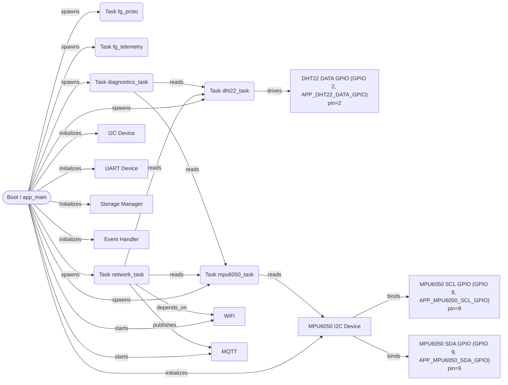
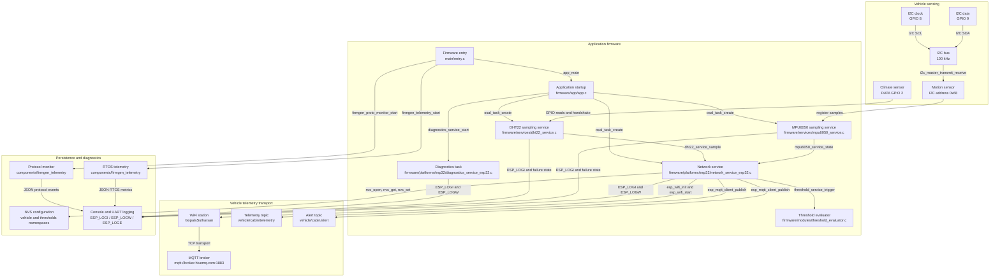
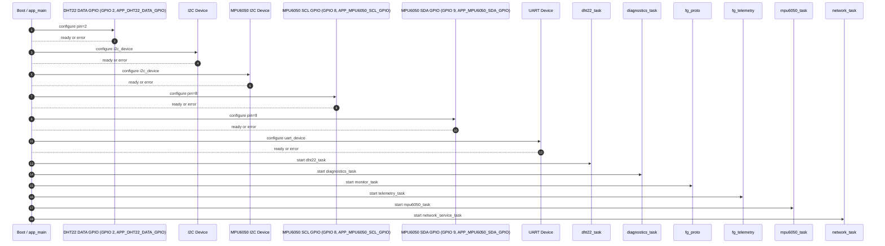
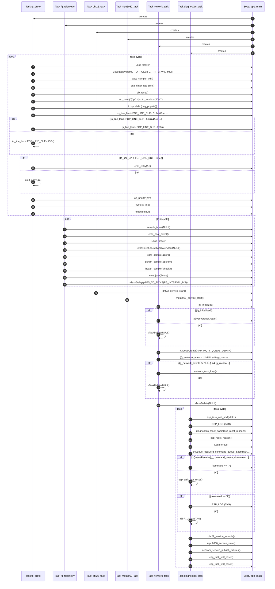
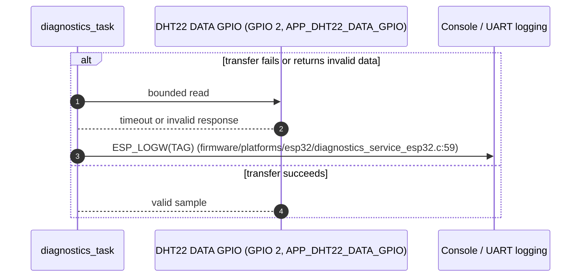
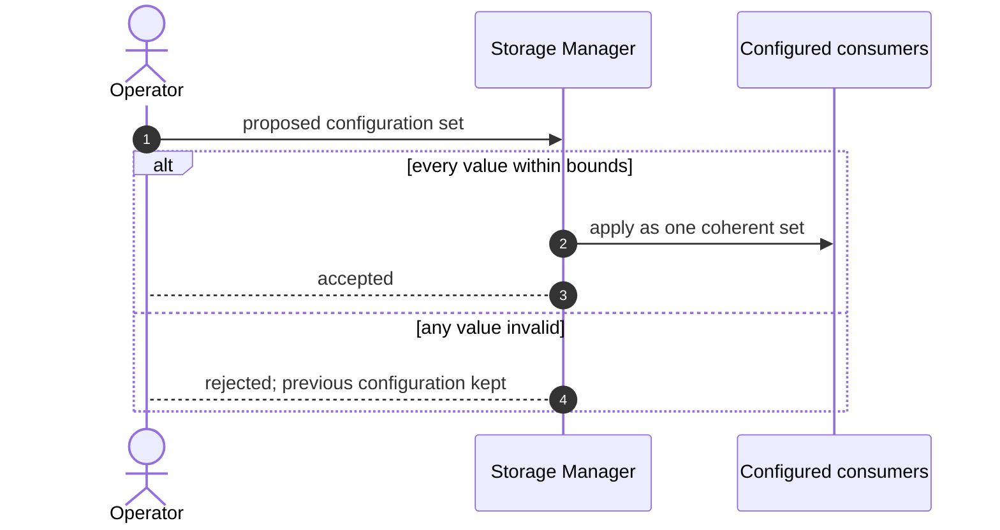

# Firmware Design Specification — vehicle_monitor

| Field | Value |
| --- | --- |
| Document ID | FDS-VEHICLE-MONITOR-001 |
| Project | vehicle_monitor |
| PIR revision | 86a23f881097aa36b54fdf893f3e81f7 |
| Board | ESP32-C3-DevKitM-1 |
| Target | esp32c3 |
| Generated | 2026-09-24 09:15 UTC |
| Analysed files | 39 |
| Diagrams reviewed | not yet |
| Requirements workbook | none linked |
| Status | Generated from the as-built project |

> Generation rule: unresolved implementation details are surfaced as editable parameters or design decisions. They are not silently converted into fixed product behavior.

## 1. Purpose and Scope

### 1.1 Source Basis

| Source | Use in this specification |
| --- | --- |
| Analysed project sources (39 files) | Primary input. Every module, task flow, pin binding and partition in this document is read from these files. |
| PIR revision 86a23f881097aa36b54fdf893f3e81f7 | The exact analysis this document describes. Regenerating after a source change produces a different revision. |
| Board record ESP32-C3-DevKitM-1 | Board-level resolution of pin names, peripherals and connectors. |
| Target esp32c3 | Device capability reference for the peripherals the firmware configures. |

### 1.2 Modelling Basis

The structure of this document follows the information content of an IEEE 1016 software design description and the viewpoint structure of ISO/IEC/IEEE 42010. Interaction diagrams use UML sequence notation. The structure is a reference template; it does not claim certification to those standards.

### 1.4 Analysed Source Inventory

| File | Module | Module kind | Facts read from this file |
| --- | --- | --- | --- |
| CMakeLists.txt | — | — | read; no facts cited from it |
| components/firmgen_telemetry/firmgen_proto_monitor.c | components/firmgen_telemetry | module | 4 topology element(s); 1 include dependency(ies); 14 control-flow step(s) |
| components/firmgen_telemetry/firmgen_telemetry.c | components/firmgen_telemetry | module | 1 topology element(s); 10 control-flow step(s) |
| components/firmgen_telemetry/include/firmgen_proto_monitor.h | components/firmgen_telemetry/include | module | read; no facts cited from it |
| components/firmgen_telemetry/include/firmgen_telemetry.h | components/firmgen_telemetry/include | module | read; no facts cited from it |
| firmware/app/app.c | app | application | 3 topology element(s); 5 include dependency(ies); 4 control-flow step(s) |
| firmware/app/app.h | app | application | read; no facts cited from it |
| firmware/bsp/board.c | bsp | board | read; no facts cited from it |
| firmware/bsp/board.h | bsp | board | 1 include dependency(ies) |
| firmware/configs/app_config.h | configs | configuration | 5 topology element(s) |
| firmware/configs/build_config.h | configs | configuration | read; no facts cited from it |
| firmware/configs/feature_config.h | configs | configuration | read; no facts cited from it |
| firmware/configs/platform_config.h | configs | configuration | read; no facts cited from it |
| firmware/drivers/mpu6050/mpu_6000_mpu_6050/mpu6050.c | drivers/mpu6050/mpu_6000_mpu_6050 | driver | read; no facts cited from it |
| firmware/drivers/mpu6050/mpu_6000_mpu_6050/mpu6050.h | drivers/mpu6050/mpu_6000_mpu_6050 | driver | read; no facts cited from it |
| firmware/interfaces/dht22_port.h | interfaces | module | read; no facts cited from it |
| firmware/interfaces/mpu6050_port.h | interfaces | module | read; no facts cited from it |
| firmware/interfaces/network_service.h | interfaces | module | read; no facts cited from it |
| firmware/modules/threshold_evaluator.c | modules | module | 1 include dependency(ies) |
| firmware/osal/osal.h | osal | abstraction | read; no facts cited from it |
| firmware/platforms/esp32/dht22_port_esp32.c | platforms/esp32 | platform | 1 topology element(s); 2 include dependency(ies) |
| firmware/platforms/esp32/diagnostics_service_esp32.c | platforms/esp32 | platform | 1 topology element(s); 1 include dependency(ies); 14 control-flow step(s) |
| firmware/platforms/esp32/mpu6050_port_esp32.c | platforms/esp32 | platform | read; no facts cited from it |
| firmware/platforms/esp32/network_service_esp32.c | platforms/esp32 | platform | 2 topology element(s); 7 control-flow step(s) |
| firmware/platforms/esp32/osal_freertos.c | platforms/esp32 | platform | 1 include dependency(ies) |
| firmware/platforms/esp32/threshold_service_esp32.c | platforms/esp32 | platform | read; no facts cited from it |
| firmware/services/dht22_service.c | services | module | 2 include dependency(ies) |
| firmware/services/dht22_service.h | services | module | read; no facts cited from it |
| firmware/services/diagnostics_service.h | services | module | read; no facts cited from it |
| firmware/services/mpu6050_service.c | services | module | 2 include dependency(ies) |
| firmware/services/mpu6050_service.h | services | module | read; no facts cited from it |
| firmware/services/threshold_service.h | services | module | read; no facts cited from it |
| firmware/utils/helpers/helpers.c | utils/helpers | utility | read; no facts cited from it |
| firmware/utils/helpers/helpers.h | utils/helpers | utility | read; no facts cited from it |
| firmware/utils/logger/logger.c | utils/logger | utility | read; no facts cited from it |
| firmware/utils/logger/logger.h | utils/logger | utility | read; no facts cited from it |
| main/entry.c | main | entrypoint | 1 topology element(s); 2 include dependency(ies) |
| sdkconfig | — | — | read; no facts cited from it |
| sdkconfig.defaults | — | — | read; no facts cited from it |

## 2. System Context and Wiring Topology

> The diagrams in this document have not been marked reviewed in the Firmware Topology panel. They describe the analysed project as it stands; review them there before treating this document as approved.

**Figure 1.** Wiring and external connectivity topology.

### 2.1 Wiring Control Table

| Connection | Baseline | Editability | Verification |
| --- | --- | --- | --- |
| DHT22 DATA GPIO (GPIO 2, APP_DHT22_DATA_GPIO) | GPIO 2 | User — editable in the node inspector | Pin is input-capable at the expected level. |
| MPU6050 SCL GPIO (GPIO 8, APP_MPU6050_SCL_GPIO) | GPIO 8 | User — editable in the node inspector | Pin is input-capable at the expected level. |
| MPU6050 SDA GPIO (GPIO 9, APP_MPU6050_SDA_GPIO) | GPIO 9 | User — editable in the node inspector | Pin is input-capable at the expected level. |
| MQTT (mqtt) | mqtt://broker.hivemq.com:1883 | User — editable in the node inspector | Endpoint reachable from the deployment network. |
| WiFi (wifi) | WIFI | User — editable in the node inspector | Endpoint reachable from the deployment network. |

### 2.2 Dynamic Design Parameters

| Parameter group | Resolved baseline | Still requires decision |
| --- | --- | --- |
| Peripherals | 6 peripheral(s): DHT22 DATA GPIO (GPIO 2, APP_DHT22_DATA_GPIO), I2C Device, MPU6050 I2C Device, MPU6050 SCL GPIO (GPIO 8, APP_MPU6050_SCL_GPIO), MPU6050 SDA GPIO (GPIO 9, APP_MPU6050_SDA_GPIO), UART Device; buses: i2c, uart | Refine tried to set `macro` on node dht22_data_gpio; hardware facts come from extraction only. Refine tried to set `mode` on node dht22_data_gpio; hardware facts come from extraction only. Refine tried to set `pull_up` on node dht22_data_gpio; hardware facts come from extraction only. Refine tried to set `pull_down` on node dht22_data_gpio; hardware facts come from extraction only. Refine tried to set `interrupt` on node dht22_data_gpio; hardware facts come from extraction only. Rejected refine edge edge because source/target nodes are not evidence-backed |
| Runtime | 6 task(s): dht22_task (aperiodic), diagnostics_task (aperiodic), monitor_task (aperiodic), telemetry_task (aperiodic), mpu6050_task (aperiodic), network_service_task (aperiodic) |  |
| Network | Transports: mqtt, wifi |  |

### 2.3 Peripheral and Interface Configuration

| Element | Type | Configured values | Source |
| --- | --- | --- | --- |
| Boot / app_main | system_init | target = esp32c3 | main/entry.c |
| DHT22 DATA GPIO (GPIO 2, APP_DHT22_DATA_GPIO) | gpio_input | pin = 2 | firmware/configs/app_config.h:11 |
| MPU6050 SCL GPIO (GPIO 8, APP_MPU6050_SCL_GPIO) | gpio_input | pin = 8 | firmware/configs/app_config.h |
| MPU6050 SDA GPIO (GPIO 9, APP_MPU6050_SDA_GPIO) | gpio_input | pin = 9 | firmware/configs/app_config.h |
| Task fg_proto | rtos_task | period_ms = 0.0; priority = 5; stack_size = 4096; task_name = fg_proto | components/firmgen_telemetry/firmgen_proto_monitor.c |
| Task fg_telemetry | rtos_task | period_ms = 0.0; priority = 5; stack_size = 4096; task_name = fg_telemetry | components/firmgen_telemetry/firmgen_telemetry.c |
| Task dht22_task | rtos_task | period_ms = 0.0; priority = 5; stack_size = 4096; task_name = dht22_task | firmware/app/app.c |
| Task mpu6050_task | rtos_task | period_ms = 0.0; priority = 5; stack_size = 4096; task_name = mpu6050_task | firmware/app/app.c |
| Task network_task | rtos_task | period_ms = 0.0; priority = 5; stack_size = 4096; task_name = network_task | firmware/app/app.c |
| Task diagnostics_task | rtos_task | period_ms = 0.0; priority = 5; stack_size = 4096; task_name = diagnostics_task | firmware/platforms/esp32/diagnostics_service_esp32.c |
| WiFi | wifi_manager | mode = station; password = set, not printed; ssid = GopalaSutharsan | firmware/configs/app_config.h |
| MQTT | mqtt_client | broker_url = mqtt://broker.hivemq.com:1883; qos = 0 | components/firmgen_telemetry/firmgen_proto_monitor.c |
| I2C Device | i2c_device | address = 0x68; clock_hz = 100000 | components/firmgen_telemetry/firmgen_proto_monitor.c |
| UART Device | uart_device | baud_rate = 115200; port = 1 | components/firmgen_telemetry/firmgen_proto_monitor.c |
| MPU6050 I2C Device | i2c_device | address = 0x68U; clock_hz = 100000 | firmware/configs/app_config.h |
| Storage Manager | storage_manager | backend = nvs; namespace = app | firmware/platforms/esp32/network_service_esp32.c |
| Event Handler | event_handler | event_id = -1 | firmware/platforms/esp32/network_service_esp32.c |

## 3. High-Level Design (HLD)

**Figure 2.** High-level layered firmware architecture and dependency direction.

### 3.1 Architectural Layers

| Layer | Source modules | Runtime and hardware elements |
| --- | --- | --- |
| Application | app, main | Task fg_proto, Task fg_telemetry, Task dht22_task, Task mpu6050_task, Task network_task, Task diagnostics_task, Event Handler, WiFi, MQTT |
| Platform and drivers | bsp, drivers/mpu6050/mpu_6000_mpu_6050, osal, platforms/esp32 | DHT22 DATA GPIO (GPIO 2, APP_DHT22_DATA_GPIO), MPU6050 SCL GPIO (GPIO 8, APP_MPU6050_SCL_GPIO), MPU6050 SDA GPIO (GPIO 9, APP_MPU6050_SDA_GPIO), I2C Device, UART Device, MPU6050 I2C Device |
| Configuration and support | configs, utils/helpers, utils/logger | Boot / app_main, Storage Manager |

### 3.2 Runtime Task Model

| Task | Nominal trigger | Owns / calls | Blocking policy |
| --- | --- | --- | --- |
| fg_proto (monitor_task) | Event driven; no period established | ob_printf("{\"p\":\"proto_monitor\",\"v\":3,\"ts_…), ob_printf("]}\n") | Decision Required — priority and stack size are not established by static analysis |
| fg_telemetry (telemetry_task) | Event driven; no period established | — | Decision Required — priority and stack size are not established by static analysis |
| dht22_task (dht22_task) | Event driven; no period established | — | Decision Required — priority and stack size are not established by static analysis |
| mpu6050_task (mpu6050_task) | Event driven; no period established | — | Decision Required — priority and stack size are not established by static analysis |
| network_task (network_service_task) | Event driven; no period established | — | Decision Required — priority and stack size are not established by static analysis |
| diagnostics_task (diagnostics_task) | Event driven; no period established | ESP_LOGI(TAG), network_service_publish_failures(), ESP_LOGW(TAG) | Decision Required — priority and stack size are not established by static analysis |

### 3.4 Build Components

| Component | Path | Requires | Source files |
| --- | --- | --- | --- |
| main | main/CMakeLists.txt | esp_driver_gpio, esp_driver_i2c, esp_timer, esp_wifi, esp_event, esp_netif, mqtt, nvs_flash, freertos, log, firmgen_telemetry | — |

## 4. Low-Level Design (LLD)

**Figure 3.** Low-level module contracts and runtime control flow.

```mermaid
flowchart TD
  subgraph DhtTask["dht22_task"]
    dht_init["Open DHT22 port<br/>dht22_service.c:67"]
    dht_read["Read frame and verify checksum<br/>dht22_service.c:80"]
    dht_retry{"Read valid — dht22_service.c:80"}
    dht_store["Decode and publish climate sample<br/>dht22_service.c:81"]
    dht_fail["Increment failure count<br/>dht22_service.c:87"]
    dht_wait["Wait 2000 ms<br/>dht22_service.c:92"]
    dht_init -->  dht_read -->  dht_retry
    dht_retry -->|yes| dht_store -->  dht_wait -->  dht_read
    dht_retry -->|no| dht_fail -->  dht_wait
  end
  subgraph MpuTask["mpu6050_task"]
    mpu_start["Start I2C and initialize sensor<br/>mpu6050_service.c:92"]
    mpu_ready{"Sensor initialized — mpu6050_service.c:117"}
    mpu_sample["Read accelerometer sample<br/>mpu6050_service.c:120"]
    mpu_sample_ok{"Sample read succeeds — mpu6050_service.c:120"}
    mpu_state["Update vehicle-axis state<br/>mpu6050_service.c:122"]
    mpu_error["Count initialization or read failure<br/>mpu6050_service.c:118"]
    mpu_delay["Wait 100 ms or retry after 1000 ms<br/>mpu6050_service.c:118"]
    mpu_start -->  mpu_ready
    mpu_ready -->|no| mpu_error -->  mpu_delay -->  mpu_start
    mpu_ready -->|yes| mpu_sample -->  mpu_sample_ok
    mpu_sample_ok -->|yes| mpu_state -->  mpu_delay -->  mpu_start
    mpu_sample_ok -->|no| mpu_error
  end
  subgraph NetworkTask["network_task"]
    net_nvs["Initialize NVS and load thresholds<br/>network_service_esp32.c:365"]
    net_wifi["Start WiFi station<br/>network_service_esp32.c:214"]
    net_mqtt["Start MQTT client<br/>network_service_esp32.c:251"]
    net_retry{"WiFi retry requested — network_service_esp32.c:374"}
    net_read["Read latest climate and motion state<br/>network_service_esp32.c:382"]
    net_valid{"Both samples valid — network_service_esp32.c:385"}
    net_publish["Publish telemetry or queue it<br/>network_service_esp32.c:389"]
    net_alert{"Threshold exceeded — network_service_esp32.c:393"}
    net_alert_publish["Publish or queue alert<br/>network_service_esp32.c:396"]
    net_flush["Flush queued MQTT messages<br/>network_service_esp32.c:391"]
    net_wait["Wait until next telemetry period<br/>network_service_esp32.c:407"]
    net_nvs -->  net_wifi -->  net_mqtt -->  net_retry
    net_retry -->|yes| net_read
    net_retry -->|no| net_read
    net_read -->  net_valid
    net_valid -->|yes| net_publish -->  net_alert
    net_valid -->|no| net_wait
    net_alert -->|yes| net_alert_publish -->  net_flush -->  net_wait
    net_alert -->|no| net_flush
    net_wait -->  net_retry
  end
  subgraph DiagnosticsTask["diagnostics_task"]
    diag_watchdog["Register task watchdog<br/>diagnostics_service_esp32.c:48"]
    diag_status["Log startup health status<br/>diagnostics_service_esp32.c:51"]
    diag_receive["Wait for command up to 250 ms<br/>diagnostics_service_esp32.c:56"]
    diag_command{"Command is question mark — diagnostics_service_esp32.c:57"}
    diag_health["Log DHT22, IMU, and MQTT failures<br/>diagnostics_service_esp32.c:59"]
    diag_unknown["Log unknown diagnostics command<br/>diagnostics_service_esp32.c:64"]
    diag_reset["Reset task watchdog<br/>diagnostics_service_esp32.c:67"]
    diag_watchdog -->  diag_status -->  diag_receive -->  diag_command
    diag_command -->|yes| diag_health -->  diag_reset -->  diag_receive
    diag_command -->|no command or other| diag_unknown -->  diag_reset
  end
  subgraph ProtocolMonitorTask["fg_proto"]
    proto_start["Start protocol monitor<br/>main/entry.c:10"]
    proto_capture["Capture I2C, WiFi, UART, and MQTT events<br/>firmgen_proto_monitor.c"]
    proto_emit["Emit protocol JSON on UART0<br/>firmgen_proto_monitor.c"]
    proto_start -->  proto_capture -->  proto_emit -->|500 ms| proto_capture
  end
  subgraph TelemetryTask["fg_telemetry"]
    telemetry_start["Start RTOS telemetry<br/>main/entry.c:9"]
    telemetry_boot["Emit previous reset report<br/>firmgen_telemetry.c"]
    telemetry_sample["Sample heap, CPU, tasks, and uptime<br/>firmgen_telemetry.c"]
    telemetry_emit["Emit RTOS JSON on UART0<br/>firmgen_telemetry.c"]
    telemetry_start -->  telemetry_boot -->  telemetry_sample -->  telemetry_emit -->|500 ms| telemetry_sample
  end
```

**Figure 4.** Peripheral service state machine for initialisation, fault containment and controlled recovery.

```mermaid
flowchart LR
    state_entry(("diagnostics_task entry<br/>start of cycle"))
    state_f1("Task diagnostics_task<br/>firmware/platforms/esp32/diagnostics_service_es…")
    state_f2("esp_task_wdt_add#40;NULL#41;<br/>firmware/platforms/esp32/diagnostics_service_es…")
    state_f3("ESP_LOGI#40;TAG#41;<br/>firmware/platforms/esp32/diagnostics_service_es…")
    state_f4("diagnostics_reset_name#40;esp_reset_reason#40;#41;#41;<br/>firmware/platforms/esp32/diagnostics…")
    state_f5("esp_reset_reason#40;#41;<br/>firmware/platforms/esp32/diagnostics_service_es…")
    state_f6("Loop forever<br/>firmware/platforms/esp32/diagnostics_service_es…")
    state_f7{"#40;xQueueReceive#40;g_command_queue, &comman… — firmware/platforms/esp32/diagnostics_s…"}
    state_f8{"#40;command == '?'#41; — firmware/platforms/esp32/diagnostics_service_es…"}
    state_f9("ESP_LOGI#40;TAG#41;<br/>firmware/platforms/esp32/diagnostics_service_es…")
    state_f10("dht22_service_sample#40;#41;<br/>firmware/platforms/esp32/diagnostics_service_es…")
    state_f11("mpu6050_service_state#40;#41;<br/>firmware/platforms/esp32/diagnostics_service_es…")
    state_f12("network_service_publish_failures#40;#41;<br/>firmware/platforms/esp32/diagnostics_service…")
    state_f13(("ESP_LOGW#40;TAG#41;<br/>firmware/platforms/esp32/diagnostics_service_es…"))
    state_f14("esp_task_wdt_reset#40;#41;<br/>firmware/platforms/esp32/diagnostics_service_es…")
    state_entry --> state_f1
    state_f1 --> state_f2
    state_f2 --> state_f3
    state_f3 --> state_f4
    state_f4 --> state_f5
    state_f5 --> state_f6
    state_f6 --> state_f7
    state_f7 -->|yes| state_f8
    state_f8 -->|yes| state_f9
    state_f9 --> state_f10
    state_f10 --> state_f11
    state_f11 --> state_f12
    state_f12 -->|no| state_f13
    state_f13 --> state_f14
    state_f14 -.->|next cycle| state_entry
```

### 4.1 Module Contracts

| Module | Kind | Files | Depends on | Trace |
| --- | --- | --- | --- | --- |
| app | application | 2 | configs, interfaces, osal, services, utils_logger | firmware/app/app.c:2 |
| bsp | board | 2 | configs | firmware/bsp/board.h:18 |
| components/firmgen_telemetry | module | 2 | components_firmgen_telemetry_include | components/firmgen_telemetry/firmgen_proto_monitor.c:37 |
| components/firmgen_telemetry/include | module | 2 | — | components/firmgen_telemetry/include |
| configs | configuration | 4 | — | configs |
| drivers/mpu6050/mpu_6000_mpu_6050 | driver | 2 | — | drivers/mpu6050/mpu_6000_mpu_6050 |
| interfaces | module | 3 | — | interfaces |
| main | entrypoint | 1 | app, components_firmgen_telemetry_include | main/entry.c:2 |
| modules | module | 1 | services | firmware/modules/threshold_evaluator.c:1 |
| osal | abstraction | 1 | — | osal |
| platforms/esp32 | platform | 6 | configs, interfaces, osal, services | firmware/platforms/esp32/dht22_port_esp32.c:6 |
| services | module | 6 | configs, drivers_mpu6050_mpu_6000_mpu_6050, interfaces, utils_logger | firmware/services/dht22_service.c:5 |
| utils/helpers | utility | 2 | — | utils/helpers |
| utils/logger | utility | 2 | — | utils/logger |

### 4.3 Failure Handling

| Condition | Handling | Trace |
| --- | --- | --- |
| (s_line_len > FGP_LINE_BUF - 512u && e.… | Branches the cycle of monitor_task. | components/firmgen_telemetry/firmgen_proto_monitor.c:553 |
| (s_line_len > FGP_LINE_BUF - 256u) | Branches the cycle of monitor_task. | components/firmgen_telemetry/firmgen_proto_monitor.c:554 |
| (!g_initialized) | Branches the cycle of network_service_task. | firmware/platforms/esp32/network_service_esp32.c:336 |
| ((g_network_events != NULL) && (g_messa… | Branches the cycle of network_service_task. | firmware/platforms/esp32/network_service_esp32.c:339 |
| (xQueueReceive(g_command_queue, &comman… | Branches the cycle of diagnostics_task. | firmware/platforms/esp32/diagnostics_service_esp32.c:52 |
| (command == '?') | Branches the cycle of diagnostics_task. | firmware/platforms/esp32/diagnostics_service_esp32.c:53 |
| ESP_LOGW(TAG) | Error path of diagnostics_task. | firmware/platforms/esp32/diagnostics_service_esp32.c:59 |

### 4.4 Include Dependencies

| From | To | Via | Symbol | Trace |
| --- | --- | --- | --- | --- |
| app | configs | include | app_config.h | firmware/app/app.c:2 |
| app | interfaces | include | network_service.h | firmware/app/app.c:7 |
| app | osal | include | osal.h | firmware/app/app.c:6 |
| app | services | include | dht22_service.h | firmware/app/app.c:4 |
| app | utils/logger | include | logger.h | firmware/app/app.c:3 |
| bsp | configs | include | app_config.h | firmware/bsp/board.h:18 |
| components/firmgen_telemetry | components/firmgen_telemetry/include | include | firmgen_proto_monitor.h | components/firmgen_telemetry/firmgen_proto_monitor.c:37 |
| main | app | include | app.h | main/entry.c:2 |
| main | components/firmgen_telemetry/include | include | firmgen_telemetry.h | main/entry.c:3 |
| modules | services | include | threshold_service.h | firmware/modules/threshold_evaluator.c:1 |
| platforms/esp32 | configs | include | app_config.h | firmware/platforms/esp32/dht22_port_esp32.c:6 |
| platforms/esp32 | interfaces | include | dht22_port.h | firmware/platforms/esp32/dht22_port_esp32.c:1 |
| platforms/esp32 | osal | include | osal.h | firmware/platforms/esp32/osal_freertos.c:1 |
| platforms/esp32 | services | include | diagnostics_service.h | firmware/platforms/esp32/diagnostics_service_esp32.c:1 |
| services | configs | include | app_config.h | firmware/services/dht22_service.c:5 |
| services | drivers/mpu6050/mpu_6000_mpu_6050 | include | mpu6050.h | firmware/services/mpu6050_service.c:7 |
| services | interfaces | include | dht22_port.h | firmware/services/dht22_service.c:6 |
| services | utils/logger | include | logger.h | firmware/services/mpu6050_service.c:6 |

## 5. Sequence Diagrams

**Figure 5.** Startup and initialisation sequence.

**Figure 6.** Normal acquisition, processing and output sequence.

**Figure 7.** Fault detection and controlled recovery sequence.

**Figure 8.** Validated and atomic configuration update sequence.

**Figure 9.** Secure firmware download, verification, staging and activation sequence.

*Not drawn — no firmware update surface was found: no OTA or update node, and no OTA partition.*

## 6. Security and Update Design

### 6.1 Security and Update Surface

| Surface | Found in the analysed project | Consequence for this design |
| --- | --- | --- |
| Update slot | No OTA partition among the 0 declared | The image can only be replaced over the wire by re-flashing. |
| Update service | No OTA or update element in the topology | Figure 9 is not drawn; there is no update flow to verify. |
| MQTT transport | mqtt://broker.hivemq.com:1883 | The endpoint is plaintext, so payloads and any credentials carried in them are readable on the deployment network. |
| WiFi transport | Configured, but no endpoint URL was resolved | Transport security cannot be read from the sources; confirm it against the deployment configuration. |
| Secure boot and flash encryption | Not visible to static source analysis | Confirm against the build configuration; this document cannot establish either. |

## 7. Timing and Resource Budget

| Budget item | Requirement / baseline | Design status | Closure evidence |
| --- | --- | --- | --- |
| Task priorities and stack sizes | Not established by static analysis | Decision Required | Scheduler configuration review plus stack high-water measurement. |
| Flash, RAM and CPU headroom | Not established by static analysis | Decision Required | Map file plus runtime resource measurement. |

## 8. Design Decision Register

| ID | Decision | Status | Resolution path |
| --- | --- | --- | --- |
| DD-001 | Refine tried to set `macro` on node dht22_data_gpio; hardware facts come from extraction only. | Open | Resolve in the source, then re-analyse. |
| DD-002 | Refine tried to set `mode` on node dht22_data_gpio; hardware facts come from extraction only. | Open | Resolve in the source, then re-analyse. |
| DD-003 | Refine tried to set `pull_up` on node dht22_data_gpio; hardware facts come from extraction only. | Open | Resolve in the source, then re-analyse. |
| DD-004 | Refine tried to set `pull_down` on node dht22_data_gpio; hardware facts come from extraction only. | Open | Resolve in the source, then re-analyse. |
| DD-005 | Refine tried to set `interrupt` on node dht22_data_gpio; hardware facts come from extraction only. | Open | Resolve in the source, then re-analyse. |
| DD-006 | Rejected refine edge edge because source/target nodes are not evidence-backed | Open | Resolve in the source, then re-analyse. |

## 9. Requirement-to-Design Traceability

> No requirements workbook is linked to this project, so no requirement can be traced to a design element here. Link one from the project picker to populate this section.

## 10. References

| Reference | Purpose |
| --- | --- |
| Board record ESP32-C3-DevKitM-1 | Connector, pin and peripheral routing reference. |
| esp32c3 device documentation | Peripheral capability and electrical reference. |
| Project sources at revision 86a23f881097aa36b54fdf893f3e81f7 | The implementation this document describes. |

## 11. Consolidated Design Summary

### 11.1 The Design at a Glance

| Aspect | As built at this revision |
| --- | --- |
| Target | esp32c3 on board ESP32-C3-DevKitM-1 |
| Analysed sources | 39 file(s) across 14 module(s) and 1 build component(s) |
| Topology | 17 element(s) and 23 connection(s), of which 23 are evidenced in source |
| Peripherals | DHT22 DATA GPIO (GPIO 2, APP_DHT22_DATA_GPIO), I2C Device, MPU6050 I2C Device, MPU6050 SCL GPIO (GPIO 8, APP_MPU6050_SCL_GPIO), MPU6050 SDA GPIO (GPIO 9, APP_MPU6050_SDA_GPIO), UART Device over i2c, uart |
| Runtime | dht22_task (aperiodic); diagnostics_task (aperiodic); monitor_task (aperiodic); telemetry_task (aperiodic); mpu6050_task (aperiodic); network_service_task (aperiodic) |
| Network | mqtt to mqtt://broker.hivemq.com:1883; wifi |
| Storage | No partition table was read |
| Figures | 8 of 9 drawn; the remaining 1 state why they are not |
| Open design decisions | 6 listed in §8 |
| Requirement traceability | No workbook is linked, so nothing is traced |
| Diagram review | Not yet marked reviewed; the figures describe the project as analysed |
| Analysis provenance | pir_maker-static-0.13.0 in hybrid_refine mode with model local_openai_proxy/gpt-5.6-luna; validation reports 0 error(s) and 0 warning(s) |

## 12. Appendix A — Term, API and Symbol Index

> Every term below is a name the body of this document uses, resolved against the 456 name(s) indexed from the 39 analysed source file(s). 61 term(s) are listed; 150 name-like token(s) in the document resolved to no recorded location and are omitted rather than listed without one.

| Term | Kind | Defined or referenced at | Where it appears in this document |
| --- | --- | --- | --- |
| APP_DHT22_DATA_GPIO | macro | firmware/configs/app_config.h:11 | §2, §3, §11; figure 1, 5, 7 |
| APP_MPU6050_SCL_GPIO | macro | firmware/configs/app_config.h:15 | §2, §3, §11; figure 1, 5 |
| APP_MPU6050_SDA_GPIO | macro | firmware/configs/app_config.h:16 | §2, §3, §11; figure 1, 5 |
| APP_MQTT_QUEUE_DEPTH | macro | firmware/configs/app_config.h:33 | figure 6 |
| ESP_LOGE | external API | firmware/platforms/esp32/diagnostics_service_esp32.c:70 | figure 2 |
| ESP_LOGI | external API | components/firmgen_telemetry/firmgen_proto_monitor.c:582 | §3; figure 2, 4, 6 |
| ESP_LOGW | external API | firmware/platforms/esp32/diagnostics_service_esp32.c:59 | §3, §4; figure 2, 4, 6, 7 |
| FGP_INTERVAL_MS | macro | components/firmgen_telemetry/firmgen_proto_monitor.c:119 | figure 6 |
| FGP_LINE_BUF | macro | components/firmgen_telemetry/firmgen_proto_monitor.c:328 | §4; figure 6 |
| FG_INTERVAL_MS | macro | components/firmgen_telemetry/firmgen_telemetry.c:69 | figure 6 |
| app_main | function | main/entry.c:6 | §2, §3; figure 1, 2, 5, 6 |
| auto_sample_wifi | function | components/firmgen_telemetry/firmgen_proto_monitor.c:485 | figure 6 |
| core_sample | function | components/firmgen_telemetry/firmgen_telemetry.c:187 | figure 6 |
| dht22_service_sample | function | firmware/services/dht22_service.c:77 | figure 2, 4, 6 |
| dht22_service_start | function | firmware/services/dht22_service.c:45 | figure 6 |
| dht22_task | function | firmware/app/app.c:12 | §2, §3, §11; figure 1, 3, 5, 6 |
| diagnostics_reset_name | function | firmware/platforms/esp32/diagnostics_service_esp32.c:24 | figure 4, 6 |
| diagnostics_service_start | function | firmware/platforms/esp32/diagnostics_service_esp32.c:66 | figure 2 |
| diagnostics_task | function | firmware/platforms/esp32/diagnostics_service_esp32.c:35 | §2, §3, §4, §11; figure 1, 3, 4, 5, 6, 7 |
| emit_boot_event | function | components/firmgen_telemetry/firmgen_telemetry.c:289 | figure 6 |
| emit_entry | function | components/firmgen_telemetry/firmgen_proto_monitor.c:399 | figure 6 |
| emit_json | function | components/firmgen_telemetry/firmgen_telemetry.c:307 | figure 6 |
| esp_mqtt_client_publish | external API | firmware/platforms/esp32/network_service_esp32.c:222 | figure 2 |
| esp_reset_reason | external API | components/firmgen_telemetry/firmgen_telemetry.c:292 | figure 4, 6 |
| esp_task_wdt_add | external API | firmware/platforms/esp32/diagnostics_service_esp32.c:46 | figure 4, 6 |
| esp_task_wdt_reset | external API | firmware/platforms/esp32/diagnostics_service_esp32.c:62 | figure 4, 6 |
| esp_timer_get_time | external API | components/firmgen_telemetry/firmgen_proto_monitor.c:505 | figure 6 |
| esp_wifi_init | external API | firmware/platforms/esp32/network_service_esp32.c:179 | figure 2 |
| esp_wifi_start | external API | firmware/platforms/esp32/network_service_esp32.c:190 | figure 2 |
| firmgen_proto_monitor_start | function | components/firmgen_telemetry/firmgen_proto_monitor.c:569 | figure 2 |
| firmgen_telemetry_start | function | components/firmgen_telemetry/firmgen_telemetry.c:400 | figure 2 |
| g_command_queue | variable | firmware/platforms/esp32/diagnostics_service_esp32.c:22 | §4; figure 4, 6 |
| g_initialized | variable | firmware/platforms/esp32/network_service_esp32.c:44 | §4; figure 6 |
| g_network_events | variable | firmware/platforms/esp32/network_service_esp32.c:42 | §4; figure 6 |
| health_sample | function | components/firmgen_telemetry/firmgen_telemetry.c:246 | figure 6 |
| i2c_master_transmit_receive | external API | firmware/platforms/esp32/mpu6050_port_esp32.c:47 | figure 2 |
| monitor_task | function | components/firmgen_telemetry/firmgen_proto_monitor.c:521 | §2, §3, §4, §11; figure 5 |
| mpu6050_service_start | function | firmware/services/mpu6050_service.c:81 | figure 6 |
| mpu6050_service_state | function | firmware/services/mpu6050_service.c:115 | figure 2, 4, 6 |
| mpu6050_task | function | firmware/app/app.c:19 | §2, §3, §11; figure 1, 3, 5, 6 |
| network_service_publish_failures | function | firmware/platforms/esp32/network_service_esp32.c:48 | §3; figure 4, 6 |
| network_service_task | function | firmware/platforms/esp32/network_service_esp32.c:333 | §2, §3, §4, §11; figure 5 |
| network_task_loop | function | firmware/platforms/esp32/network_service_esp32.c:263 | figure 6 |
| nvs_open | external API | firmware/platforms/esp32/network_service_esp32.c:64 | figure 2 |
| ob_printf | function | components/firmgen_telemetry/firmgen_proto_monitor.c:338 | §3; figure 6 |
| ob_reset | function | components/firmgen_telemetry/firmgen_proto_monitor.c:332 | figure 6 |
| osal_task_create | function | firmware/platforms/esp32/osal_freertos.c:18 | figure 2 |
| pdMS_TO_TICKS | external API | components/firmgen_telemetry/firmgen_proto_monitor.c:524 | figure 6 |
| psram_sample | function | components/firmgen_telemetry/firmgen_telemetry.c:208 | figure 6 |
| ring_pop | function | components/firmgen_telemetry/firmgen_proto_monitor.c:244 | figure 6 |
| s_line | variable | components/firmgen_telemetry/firmgen_proto_monitor.c:329 | figure 6 |
| s_line_len | variable | components/firmgen_telemetry/firmgen_proto_monitor.c:330 | §4; figure 6 |
| sample_tasks | function | components/firmgen_telemetry/firmgen_telemetry.c:116 | figure 6 |
| telemetry_task | function | components/firmgen_telemetry/firmgen_telemetry.c:374 | §2, §3, §11; figure 5 |
| threshold_service_trigger | function | firmware/modules/threshold_evaluator.c:5 | figure 2 |
| uxTaskGetStackHighWaterMark | external API | components/firmgen_telemetry/firmgen_telemetry.c:381 | figure 6 |
| vTaskDelay | external API | components/firmgen_telemetry/firmgen_proto_monitor.c:524 | figure 6 |
| vTaskDelete | external API | firmware/platforms/esp32/network_service_esp32.c:345 | figure 6 |
| xEventGroupCreate | external API | firmware/platforms/esp32/network_service_esp32.c:337 | figure 6 |
| xQueueCreate | external API | firmware/platforms/esp32/diagnostics_service_esp32.c:68 | figure 6 |
| xQueueReceive | external API | firmware/platforms/esp32/diagnostics_service_esp32.c:52 | §4; figure 4, 6 |

